# TaskFlow — MVP Specification & Project Architecture

**Project Title:** TaskFlow — Smart Task & Project Management Dashboard  
**Tagline:** *"Plan better. Work smarter."*  
**Author:** Samridhi (Python Full-Stack Intern Developer)  
**Academic Basis:** Project 1: To-Do List (Foundational Python Coursework)  
**Current Status:** Production-Ready MVP (Verified & Tested)

---

## 1. Executive Summary

TaskFlow is a modern SaaS-inspired productivity dashboard that extends the fundamental learning goals of a traditional Python console To-Do List into an enterprise-grade full-stack web application. 

While conventional student projects often discard basic concepts when migrating to web frameworks, TaskFlow preserves and explicitly highlights core Python collection patterns—lists, loops, dictionary transforms, dynamic aggregations, and Input → Process → Output flows—inside a dedicated service architecture.

---

## 2. Core Educational Mapping

| Fundamental Concept | Console To-Do Equivalent | TaskFlow Full-Stack Implementation | File Location |
| :--- | :--- | :--- | :--- |
| **Python Lists** | `tasks = []` | In-memory collection layer aggregating structured task dicts | [`app/services.py`](file:///c:/Users/samri/Downloads/to-do/app/services.py#L20-L54) |
| **`list.append()`** | `tasks.append(item)` | Accumulating database query rows transformed to dicts | [`app/services.py`](file:///c:/Users/samri/Downloads/to-do/app/services.py#L48-L52) |
| **For Loops** | `for task in tasks: print(task)` | Iterating to calculate status distributions, overdue items, weekly metrics | [`app/services.py`](file:///c:/Users/samri/Downloads/to-do/app/services.py#L125-L145) |
| **Dictionaries** | `{"title": "...", "status": "..."}` | Decoupled presentation payloads with formatted dates & flags | [`app/models.py`](file:///c:/Users/samri/Downloads/to-do/app/models.py#L70-L88) |
| **Filtering & Sorting** | `[t for t in tasks if t['status'] == 'TODO']` | Multi-parameter filtering with case-insensitive search & lambda sorting | [`app/services.py`](file:///c:/Users/samri/Downloads/to-do/app/services.py#L57-L115) |
| **Dynamic Math** | `completed / total * 100` | Metric engine with division-by-zero protection | [`app/services.py`](file:///c:/Users/samri/Downloads/to-do/app/services.py#L140-L150) |
| **Persistent Storage** | Volatile RAM list | Relational SQLite database managed via SQLAlchemy ORM | [`app/models.py`](file:///c:/Users/samri/Downloads/to-do/app/models.py) |

---

## 3. System Architecture: Input → Process → Output

```mermaid
flowchart LR
    subgraph INPUT [1. INPUT LAYER]
        A1[Web Forms: Add / Edit]
        A2[Filter & Search Queries]
        A3[AJAX Fetch Toggles]
    end

    subgraph PROCESS [2. PROCESS LAYER]
        B1[Validation & Sanitization]
        B2[Collection Transformations]
        B3[Sorting & Filtering Logic]
        B4[SQLAlchemy & SQLite DB]
    end

    subgraph OUTPUT [3. OUTPUT LAYER]
        C1[Jinja2 HTML Views]
        C2[Chart.js Visual Analytics]
        C3[Dynamic CSV Streams]
    end

    INPUT --> PROCESS --> OUTPUT
```



1. **Input Phase:**
   * User creates/edits tasks or projects via modals and form inputs.
   * User searches, filters, or sorts via URL query arguments.
   * User checks off items or toggles themes via client-side JavaScript.
2. **Process Phase:**
   * `app/services.py` verifies required fields, string lengths, and valid choice sets.
   * Database entities are fetched and converted into Python dictionary objects.
   * Python loops and conditionals perform search matching, priority scoring, and date checks.
   * SQLAlchemy commits ACID-compliant transactions to SQLite (`instance/taskflow.db`).
3. **Output Phase:**
   * Jinja2 templates render accessible HTML with responsive CSS cards.
   * JSON endpoint `/api/analytics` supplies real-time datasets to Chart.js.
   * Streaming response endpoint `/tasks/export` generates CSV downloads on demand.

---

## 4. Database Schema Specification

### 4.1 `projects` Table
* `id` (INTEGER, Primary Key)
* `name` (VARCHAR(100), NOT NULL) — Project title.
* `description` (TEXT, NULLABLE) — Overview and scope.
* `status` (VARCHAR(20), NOT NULL, DEFAULT "ACTIVE") — Options: `ACTIVE`, `ON_HOLD`, `COMPLETED`.
* `deadline` (DATE, NULLABLE) — Target completion date.
* `created_at` (DATETIME, NOT NULL) — Timezone-aware UTC timestamp.
* *Relationship:* One-to-Many with `tasks` (`cascade="all, delete-orphan"`).

### 4.2 `tasks` Table
* `id` (INTEGER, Primary Key)
* `title` (VARCHAR(150), NOT NULL) — Actionable summary (min length: 3).
* `description` (TEXT, NULLABLE) — Markdown/text instructions.
* `status` (VARCHAR(20), NOT NULL, DEFAULT "TODO") — Options: `TODO`, `IN_PROGRESS`, `COMPLETED`.
* `priority` (VARCHAR(20), NOT NULL, DEFAULT "MEDIUM") — Options: `LOW`, `MEDIUM`, `HIGH`, `URGENT`.
* `category` (VARCHAR(50), NOT NULL, DEFAULT "General") — Domain grouping (e.g., Development, Design, Testing).
* `due_date` (DATE, NULLABLE) — Target completion date.
* `created_at` (DATETIME, NOT NULL) — Creation timestamp.
* `updated_at` (DATETIME, NOT NULL) — Last modification timestamp.
* `project_id` (INTEGER, Foreign Key `projects.id`, NULLABLE).

---

## 5. Endpoints & Route Reference

| Method | Endpoint | Description | Response Type |
| :--- | :--- | :--- | :--- |
| `GET` | `/` | Dashboard with real-time metrics, weekly velocity, and recent tasks | HTML |
| `GET` | `/tasks` | Task management with multi-field search, filters, and sorting | HTML |
| `POST` | `/tasks/create` | Validate and create a new task | Redirect / JSON |
| `POST` | `/tasks/<id>/edit` | Update attributes of an existing task | Redirect / JSON |
| `POST` | `/tasks/<id>/toggle` | Toggle task completion state | JSON |
| `POST` | `/tasks/<id>/delete` | Delete a task by ID | Redirect / JSON |
| `GET` | `/projects` | Project overview cards with progress metrics | HTML |
| `POST` | `/projects/create` | Validate and create a new project | Redirect / JSON |
| `GET` | `/projects/<id>` | Project deep-dive with SVG radial progress ring | HTML |
| `GET` | `/reports` | Productivity intelligence with 4 interactive Chart.js charts | HTML |
| `GET` | `/api/analytics` | Dynamic JSON payload feeding frontend Chart.js components | JSON |
| `GET` | `/tasks/export` | Generates dynamic UTF-8 CSV spreadsheet in-memory | CSV Attachment |
| `ERR` | `404` | Friendly missing page template | HTML (404) |
| `ERR` | `500` | Friendly internal error template avoiding trace leaks | HTML (500) |

---

## 6. Verification & Automated Quality Assurance

The test suite is built on `pytest` and runs in memory (`sqlite:///:memory:`) for high-speed, isolated execution:

```powershell
.venv\Scripts\pytest.exe -v
```

* **15 Passing Automated Tests:**
  1. `test_dashboard_calculations_empty`: Safe zero-division handling.
  2. `test_dashboard_calculations_populated`: Dynamic math across task states.
  3. `test_api_analytics_endpoint`: JSON contract verification for charts.
  4. `test_export_csv_endpoint`: In-memory streaming CSV headers and row data.
  5. `test_validate_project_data`: Project length and status constraints.
  6. `test_create_project`: Persistence and ID assignment.
  7. `test_get_project_details`: Radial progress and task count calculation.
  8. `test_project_cascade_delete`: Cascade cleanup of child tasks.
  9. `test_validate_task_data_valid`: Clean input sanitation.
  10. `test_validate_task_data_invalid`: Detection of short titles and invalid choices.
  11. `test_create_task`: Task database storage.
  12. `test_toggle_task_status`: State transition logic (TODO ↔ COMPLETED).
  13. `test_update_task`: Field modifications.
  14. `test_delete_task`: Deletion verification.
  15. `test_filter_and_sort_tasks`: Multi-field filtering and priority ordering.

---

## 7. Roadmap & Future Expansion (Post-MVP)

1. **User Authentication & Authorization:** Multi-user tenancy with bcrypt password hashing and session tokens.
2. **Kanban Board View:** Drag-and-drop column workflow using HTML5 Drag and Drop API.
3. **Subtasks / Checklist:** Hierarchical tasks with parent-child progression tracking.
4. **Deadline Notifications:** Webhook or browser notification integration for overdue items.
5. **Team Collaboration:** Task assignment, activity audit logs, and comment threads.
